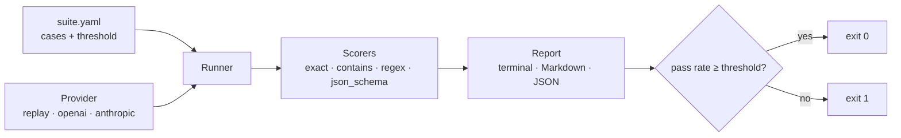

# agent-evals

Evaluate LLM agents against versioned test cases, and fail the build when quality drops.

[](https://github.com/juanmartinezjimenez/agent-evals/actions/workflows/ci.yml)

## Problem

Changing a prompt or switching models is a one-line edit with unknown side effects.
Without a fixed set of cases and a score, "it seems to work" is the only quality
check, and regressions reach production silently.

## Solution

`agent-evals` runs a suite of cases written in YAML, scores every output with
deterministic checks, and exits non-zero when the pass rate falls below the
suite's threshold. Cases live in Git, so changing what "correct" means goes
through code review like any other change.

```console
$ agent-evals run examples/ticket-classification/suite.yaml \
    --replay examples/ticket-classification/recording.yaml
PASS ticket-classification: 9/10 passed (90%, threshold 90%) · replay · latency mean 0.0 ms, p95 0.0 ms
  ✗ refund-damaged: expected 'billing', got 'shipping'
```

## How it works



A suite is a system prompt, a threshold and a list of cases:

```yaml
name: ticket-classification
threshold: 0.9
system: Answer with exactly one word: billing, technical, account or shipping.
cases:
  - id: double-charge
    input: I was charged twice for my March subscription, please refund one of them.
    expect: { type: exact, value: billing }
    tags: [billing]
```

| Scorer | Passes when |
| --- | --- |
| `exact` | Output equals the value (whitespace and case-insensitive by default) |
| `contains` | Output contains every listed value |
| `regex` | Output matches the pattern |
| `json_schema` | Output is valid JSON, matches a JSON Schema and, optionally, has the expected field values. Code fences are accepted |

Every failure says why, e.g. `wrong field values: {'name': 'Irene'}` or
`schema error at intent: 'refund' is not one of [...]`.

### Multi-turn cases

To test a conversation, give `turns` instead of `input`. Earlier turns are
written by hand; the model answers only the last user turn, and only that answer
is scored ([ADR 0006](docs/adr/0006-multi-turn-cases-with-scripted-history.md)).
Runs stay deterministic, replayable and comparable by case id.

```yaml
- id: correction-wins
  turns:
    - role: user
      content: I'd like to book a puncture repair for Marc Soler on Tuesday at 10:00.
    - role: assistant
      content: Done, Marc. You're booked for Tuesday at 10:00.
    - role: user
      content: Sorry, I meant Thursday at 17:30. What time is my booking now?
  expect: { type: regex, pattern: "(?i)thursday.*17:30" }
```

Turns start with `user`, alternate with `assistant` and end with `user`; a case
has either `input` or `turns`, never both. Earlier turns are sent on every call,
so they count as input tokens and cost.

## Quickstart

Requires [uv](https://docs.astral.sh/uv/).

```bash
git clone https://github.com/juanmartinezjimenez/agent-evals
cd agent-evals
uv sync
uv run agent-evals run examples/contact-extraction/suite.yaml \
  --replay examples/contact-extraction/recording.yaml \
  --markdown report.md --json report.json
```

### Against a real model

Install the provider you need and export its API key (never commit it):

```bash
uv sync --extra anthropic          # or --extra openai
export ANTHROPIC_API_KEY=...       # or OPENAI_API_KEY

uv run agent-evals run examples/ticket-classification/suite.yaml \
  --provider anthropic --model claude-haiku-5-5 \
  --price-input 0.10 --price-output 0.50 \
  --record my-recording.yaml
```

- `--price-input` / `--price-output` are USD per million tokens. Copy them from the
  provider's price list; nothing is hard-coded ([ADR 0004](docs/adr/0004-prices-are-user-supplied.md)).
- `--record` saves the outputs, so the same run can be replayed in CI for free.
- A failed call (rate limit, timeout, server error) fails only its case. An invalid
  key, a missing model or a permission error aborts the run with exit code `2`.

| Exit code | Meaning |
| --- | --- |
| `0` | Pass rate met the threshold |
| `1` | Suite ran but scored below the threshold |
| `2` | Suite, recordings or provider could not be set up |

### The record → replay loop

```mermaid
flowchart LR
  live[Live run<br/>real model, costs money] -- --record --> rec[recording.yaml<br/>committed to Git]
  rec -- --replay --> ci[CI on every push<br/>deterministic, free]
```

### Comparing two runs

A pass rate can hide regressions: a prompt change that fixes one case and breaks
another scores the same. `compare` matches cases by id and fails if any case that
passed in the base run fails in the head run
([ADR 0005](docs/adr/0005-compare-gates-on-case-regressions.md)).

```console
$ agent-evals run examples/ticket-classification/suite.yaml \
    --replay examples/ticket-classification/recording.yaml --json base.json
$ agent-evals run examples/ticket-classification/suite.yaml \
    --replay examples/ticket-classification/recording-new-prompt.yaml --json head.json
$ agent-evals compare base.json head.json --markdown compare.md
FAIL ticket-classification: 1 regression, 1 fix · pass rate 90% → 90% (+0 pp) · replay → replay · latency mean 0.0 → 0.0 ms, p95 0.0 → 0.0 ms
  ✗ wrong-address: expected 'shipping', got 'account'
  ✓ refund-damaged: fixed
```

| Exit code | Meaning |
| --- | --- |
| `0` | No regressions (fixes, new cases and metric changes are reported only) |
| `1` | At least one case that passed in the base run fails in the head run |
| `2` | A report could not be read, or the reports are for different suites |

Use it to compare a prompt change against `main`, or two models on the same suite.

## Examples

All suites use synthetic data only.

| Suite | Task | Cases | Recorded result |
| --- | --- | --- | --- |
| [ticket-classification](examples/ticket-classification/) | Route support tickets to one of four queues | 10 | 9/10, fails on an ambiguous refund-vs-shipping ticket |
| [contact-extraction](examples/contact-extraction/) | Extract name, email and intent as JSON | 5 | 4/5, picks the wrong person when two are mentioned |
| [workshop-booking](examples/workshop-booking/) | Book bike repair slots over a conversation (multi-turn) | 6 | 5/6, confirms a slot that does not exist |

CI runs all of them on every push and publishes the Markdown report in the job summary.

## Technical decisions

- [ADR 0002](docs/adr/0002-replay-provider-for-ci.md): a replay provider makes CI deterministic and free.
- [ADR 0003](docs/adr/0003-deterministic-scorers-first.md): deterministic scorers before LLM-as-judge.
- [ADR 0004](docs/adr/0004-prices-are-user-supplied.md): token prices are supplied by the user, not hard-coded.
- [ADR 0005](docs/adr/0005-compare-gates-on-case-regressions.md): `compare` fails on case regressions, not on metric deltas.
- [ADR 0006](docs/adr/0006-multi-turn-cases-with-scripted-history.md): multi-turn cases script the history and score only the last answer.

## Roadmap

- [x] v0.1: YAML suites, replay provider, four deterministic scorers, CLI, reports
- [x] v0.2: OpenAI and Anthropic providers, tokens, cost and p95 latency, recording real runs
- [x] v0.3: comparing two runs to detect regressions, multi-turn conversation cases
- [ ] v0.4: reusable GitHub Action that comments the report on pull requests

## Development

```bash
uv sync
uv run pytest
uv run ruff check . && uv run ruff format --check . && uv run mypy
```

## License

[MIT](LICENSE)
