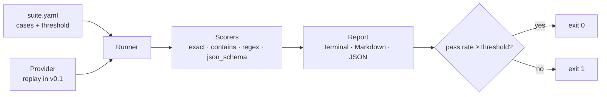

# agent-evals

Evaluate LLM agents against versioned test cases, and fail the build when quality drops.

[](https://github.com/juanmartinezjimenez/agent-evals/actions/workflows/ci.yml)

## Problem

Changing a prompt or switching models is a one-line edit with unknown side effects.
Without a fixed set of cases and a score, "it seems to work" is the only quality
check, and regressions reach production silently.

## Solution

`agent-evals` runs a suite of cases written in YAML, scores every output with
deterministic checks, and exits non-zero when the pass rate falls below the
suite's threshold. Cases live in Git, so changing what "correct" means goes
through code review like any other change.

```console
$ agent-evals run examples/ticket-classification/suite.yaml \
    --replay examples/ticket-classification/recording.yaml
PASS ticket-classification: 9/10 passed (90%, threshold 90%) · provider replay · mean latency 0.0 ms
  ✗ refund-damaged: expected 'billing', got 'shipping'
```

## How it works



A suite is a system prompt, a threshold and a list of cases:

```yaml
name: ticket-classification
threshold: 0.9
system: Answer with exactly one word: billing, technical, account or shipping.
cases:
  - id: double-charge
    input: I was charged twice for my March subscription, please refund one of them.
    expect: { type: exact, value: billing }
    tags: [billing]
```

| Scorer | Passes when |
| --- | --- |
| `exact` | Output equals the value (whitespace and case-insensitive by default) |
| `contains` | Output contains every listed value |
| `regex` | Output matches the pattern |
| `json_schema` | Output is valid JSON, matches a JSON Schema and, optionally, has the expected field values. Code fences are accepted |

Every failure says why, e.g. `wrong field values: {'name': 'Irene'}` or
`schema error at intent: 'refund' is not one of [...]`.

## Quickstart

Requires [uv](https://docs.astral.sh/uv/).

```bash
git clone https://github.com/juanmartinezjimenez/agent-evals
cd agent-evals
uv sync
uv run agent-evals run examples/contact-extraction/suite.yaml \
  --replay examples/contact-extraction/recording.yaml \
  --markdown report.md --json report.json
```

| Exit code | Meaning |
| --- | --- |
| `0` | Pass rate met the threshold |
| `1` | Suite ran but scored below the threshold |
| `2` | Suite or recordings could not be loaded |

## Examples

Both suites use synthetic data only.

| Suite | Task | Cases | Recorded result |
| --- | --- | --- | --- |
| [ticket-classification](examples/ticket-classification/) | Route support tickets to one of four queues | 10 | 9/10, fails on an ambiguous refund-vs-shipping ticket |
| [contact-extraction](examples/contact-extraction/) | Extract name, email and intent as JSON | 5 | 4/5, picks the wrong person when two are mentioned |

CI runs both on every push and publishes the Markdown report in the job summary.

## Technical decisions

- [ADR 0002](docs/adr/0002-replay-provider-for-ci.md): a replay provider makes CI deterministic and free.
- [ADR 0003](docs/adr/0003-deterministic-scorers-first.md): deterministic scorers before LLM-as-judge.

## Roadmap

- [x] v0.1: YAML suites, replay provider, four deterministic scorers, CLI, reports
- [ ] v0.2: OpenAI and Anthropic providers, cost and latency per case, recording real runs
- [ ] v0.3: per-field accuracy for extraction, comparing two runs to detect regressions
- [ ] v0.4: reusable GitHub Action that comments the report on pull requests

## Development

```bash
uv sync
uv run pytest
uv run ruff check . && uv run ruff format --check . && uv run mypy
```

## License

[MIT](LICENSE)
